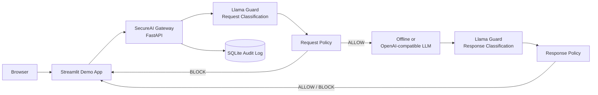

# SecureAI Gateway — Llama Guard Demo

A focused, interview-ready demo of **bidirectional Llama Guard classification**. Every prompt is
classified before inference, and every model response is classified before it reaches the user.
A separate, small policy engine converts each classification signal into an explainable action.

The default setup is deterministic and requires no Internet access, API key, GPU, or model download.
It demonstrates the Llama Guard integration pattern and policy flow; the default `mock` classifier
does **not** claim to run Meta model weights. A real compatible Llama Guard endpoint can be selected
through environment variables without changing the gateway or UI.

## Architecture



```text
Llama Guard classification → Security signal → Policy decision → ALLOW / BLOCK / LOG
```

The Streamlit app never calls the LLM directly. Prompt blocking happens before the LLM call;
response blocking happens before output is released. In this classifier-only demo, audit content
previews are deliberately omitted rather than pretending that a DLP scanner is present.

## Components

| Path | Responsibility |
|---|---|
| `ui/` | Streamlit presenter UI, three scenarios, decisions, raw signals, and events |
| `gateway/` | FastAPI gateway, Llama Guard client, policy, LLM abstraction, and audit trail |
| `llama-guard/` | Optional CPU-only deterministic HTTP adapter for testing the `/classify` boundary |
| `gateway/app/policy/policies.yaml` | Configurable risk, action, reason, and policy labels |

Endpoints:

- `POST /v1/chat` — request classification, inference, response classification, enforcement
- `GET /events?limit=50` — recent classification and policy events
- `DELETE /events` — clear demo history before a rehearsal or interview
- `GET /health` — gateway, classifier, LLM, and audit status without credentials
- `GET /docs` — interactive FastAPI documentation

## Start with Docker Compose

```bash
cp .env.example .env
docker compose up --build -d
docker compose ps
```

Open [http://localhost:8501](http://localhost:8501), replacing `localhost` with the NAS hostname or
address when accessed from another device. Gateway diagnostics are exposed on port 8080.

Default `.env.example` settings:

```dotenv
LLAMA_GUARD_MODE=mock
LLAMA_GUARD_URL=http://llama-guard:8000
LLM_MODE=offline
DEMO_OFFLINE_MODE=true
```

This is the most reliable interview configuration. Mock mode supplies deterministic Llama Guard-shaped
classification responses, while the gateway HTTP pipeline, pre/post inspection, policy enforcement,
LLM call boundary, and audit database remain real.

## Three demo scenarios

Choose a scenario and then press **Send through SecureAI Gateway**.

| Scenario | Expected result | What it proves |
|---|---|---|
| Normal Request | Request `SAFE`, response `SAFE`, `LOW / ALLOW` | Valid AI traffic remains uninterrupted |
| Unsafe Prompt | Request `UNSAFE`, `HIGH / BLOCK` | Harmful-content classification blocks before inference |
| Unsafe Response | Request `SAFE / ALLOW`, response `UNSAFE / BLOCK` | Output inspection is required as well as input inspection |

The unsafe-response scenario uses a benign synthetic statement about a prohibited capability and never
contains actionable harmful material. It does not depend on a model producing harmful output. All content is omitted from audit
previews; only metadata such as direction, classification, category, action, and latency is stored.

The UI expands Llama Guard taxonomy codes into readable labels (for example,
`S2 · Non-Violent Crimes`) while preserving the model's original category code in the API and audit log.

## Runtime switches

The demo page routes each request independently using two controls:

- **Guardrail:** Offline Demo, Online, or Local (NAS)
- **Backend LLM:** Offline Demo, Online, or Local (NAS)

The compact status badges use presentation-friendly labels such as **Guardrail Online** and
**Backend Online**. Provider names are not shown as classification modes or detector values.

## Classifier modes

### Reliable mock mode

```dotenv
LLAMA_GUARD_MODE=mock
```

The gateway classifies known demo scenarios in-process. The UI clearly labels this as Demo
Classification Mode.

### Local HTTP adapter

Select **Local (NAS)** on the page. The bundled adapter starts with the stack; to build it explicitly:

```bash
docker compose up --build -d
```

This exercises a real separate HTTP service and `/classify` contract, but the included CPU-only adapter
is still deterministic. It is a deployment-wiring step, not real Llama Guard model inference.

### Real or remote Llama Guard

Point the gateway at any service implementing this contract:

```http
POST /classify
Content-Type: application/json

{"direction":"request","content":"User supplied text"}
```

```json
{"classification":"safe","category":null,"confidence":0.98}
```

Configure:

```dotenv
LLAMA_GUARD_MODE=remote
LLAMA_GUARD_URL=http://your-guard-host:8000
```

For a CPU/GPU VM, the topology is `NAS (UI + gateway) → HTTP → VM (Llama Guard API)`. Restrict the
endpoint to the NAS, and add authentication/TLS outside an isolated demo network. No address is
hardcoded in the project.

If the classifier is unavailable, the gateway emits an `unavailable` signal and applies the configured
`MEDIUM / LOG` fallback instead of crashing the presentation.

### Cloudflare AI Gateway

The gateway can call Llama Guard 3 through Cloudflare's OpenAI-compatible endpoint:

```dotenv
LLAMA_GUARD_MODE=cloudflare
LLAMA_GUARD_URL=https://gateway.ai.cloudflare.com/v1/ACCOUNT_ID/GATEWAY_ID/compat/chat/completions
LLAMA_GUARD_API_KEY=read-from-a-secret-store
LLAMA_GUARD_MODEL=workers-ai/@cf/meta/llama-guard-3-8b
LLAMA_GUARD_TIMEOUT_SECONDS=30
```

For `gateway.ai.cloudflare.com`, authentication is sent only as
`cf-aig-authorization: Bearer …`. The secret is never returned by health checks or stored in audit
events. Llama Guard produces textual `safe` or `unsafe` output with category codes; the adapter parses
that output and leaves confidence empty because the model does not provide a calibrated score.

## LLM modes

Offline inference is deterministic. To use an OpenAI-compatible endpoint:

```dotenv
LLM_MODE=openai
LLM_BASE_URL=https://your-provider.example/v1
LLM_API_KEY=read-from-your-secret-store
LLM_MODEL=your-model-id
DEMO_OFFLINE_MODE=true
```

The selected backend is authoritative: if Online or Local is unavailable, the UI reports the failure
instead of silently changing modes. API credentials are never returned by health checks or written to
audit events.

For the page's online backend option, configure the same AI Gateway completion endpoint and Kimi K2.6:

```dotenv
LLM_ONLINE_URL=https://gateway.ai.cloudflare.com/v1/ACCOUNT_ID/GATEWAY_ID/compat/chat/completions
LLM_ONLINE_API_KEY=read-from-a-secret-store
LLM_ONLINE_MODEL=workers-ai/@cf/moonshotai/kimi-k2.6
```

The NAS stack includes a private CPU-only Ollama runtime. Local Guardrail runs the real
`llama-guard3:1b` model, while Local Backend uses the low-resource `qwen2.5:0.5b-instruct` model.
Their default settings are:

```dotenv
LLAMA_GUARD_LOCAL_URL=http://llama-guard:8000
OLLAMA_GUARD_MODEL=llama-guard3:1b
LLM_LOCAL_URL=http://ollama:11434/v1
LLM_LOCAL_MODEL=qwen2.5:0.5b-instruct
```

The Ollama and local guard adapter ports are not published to the LAN; only services on the private
Compose network can reach them. Model weights persist in the `secureai-gateway-ollama-models` Docker
volume.

## NAS deployment

The Compose file is vendor-neutral.

- **Terminal/SSH:** copy the repository to a persistent NAS directory, create `.env`, and run
  `docker compose up --build -d`.
- **Container Manager UI:** import `docker-compose.yml` as a project/stack, add values from
  `.env.example`, build, and start. Exact labels vary by NAS OS version.

The `secureai-gateway-audit-data` named volume avoids common NAS bind-mount ownership issues. Publish
port 8501 for the UI. Port 8080 is optional for troubleshooting; the guard port should stay internal
unless a remote gateway must access it.

## Troubleshooting

```bash
docker compose ps
docker compose logs --tail=100 gateway ui
curl -s http://localhost:8080/health
curl -s 'http://localhost:8080/events?limit=5'
```

- UI waiting during startup: verify the gateway health check.
- `classifier unavailable`: test the configured guard `/health` endpoint from the gateway network.
- Cloud LLM error: keep `DEMO_OFFLINE_MODE=true` for automatic fallback.
- Audit unavailable: inference continues; inspect gateway logs and named-volume permissions.

## 15-minute interview runbook

**Minute 0–3 — architecture.** Explain that every input and output crosses the gateway. Llama Guard
provides classification; the policy engine provides consistent enforcement.

**Minute 3–6 — Normal Request.** Run it and show request and response are both `SAFE`, ending in
`LOW / ALLOW`. Security should stay out of valid traffic's way.

**Minute 6–10 — Unsafe Prompt.** Run the non-actionable credential-theft request. Show `REQUEST`,
`UNSAFE`, `HIGH / BLOCK`, and explain that the downstream LLM was never called.

**Minute 10–13 — Unsafe Response.** Show the request passes but the seeded response is classified
`UNSAFE` and blocked. This is the reason inspection must be bidirectional.

**Minute 13–15 — Audit.** Refresh events and highlight direction, category, confidence, policy action,
latency, and content minimization. Close with: **Llama Guard supplies the safety classification signal;
the gateway consistently applies it before and after inference.**

Before the interview, keep mock/offline mode enabled and run all three scenarios once.

## Tests

```bash
python -m venv .venv
source .venv/bin/activate
pip install -r gateway/requirements-dev.txt -r ui/requirements.txt
pytest
```

Tests cover policy mapping, safe request/response flow, proof that blocked prompts never call the LLM,
unsafe response blocking, audit direction, and content-minimized previews.
